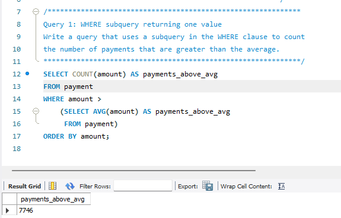
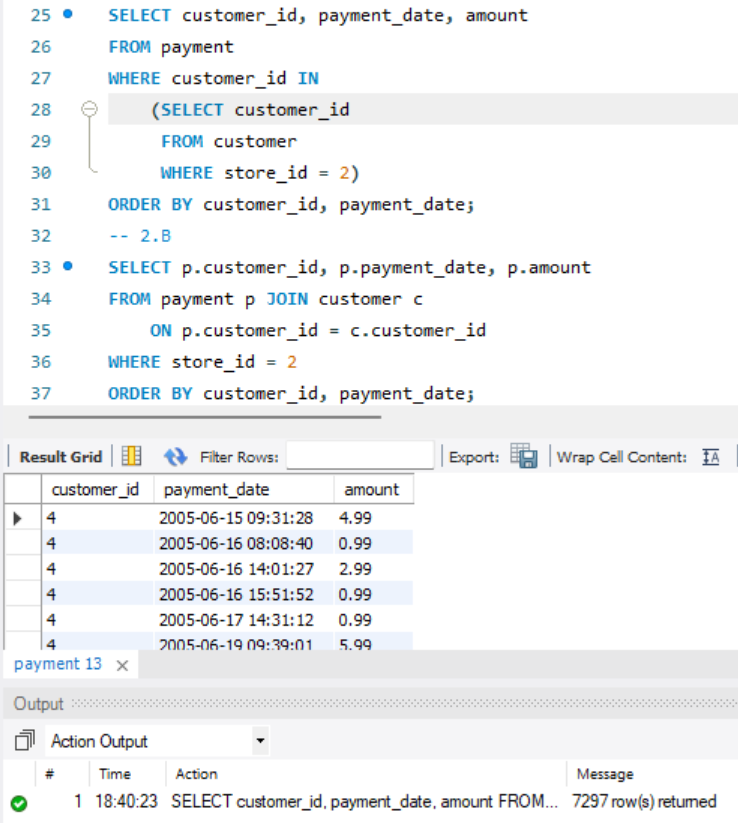
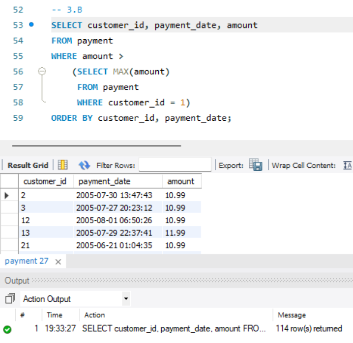
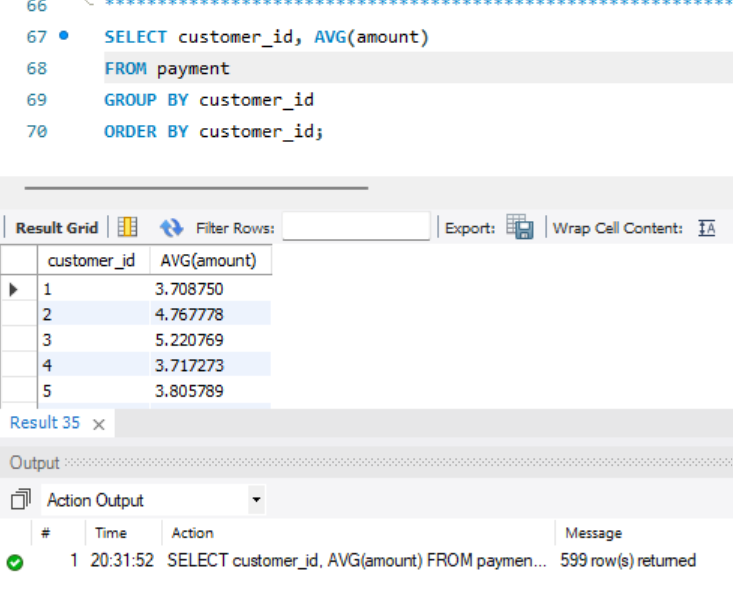
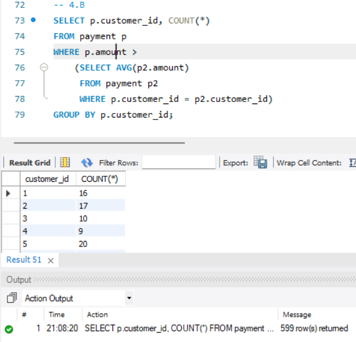
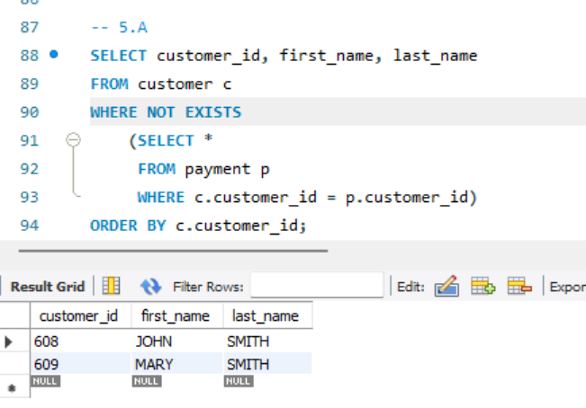
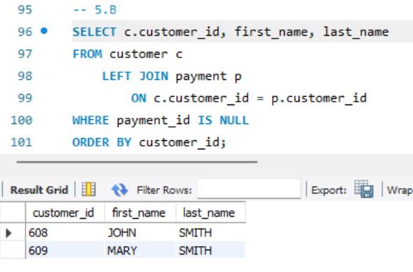
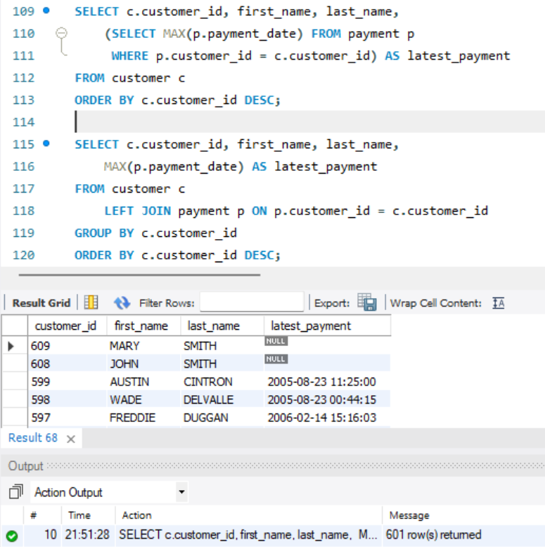
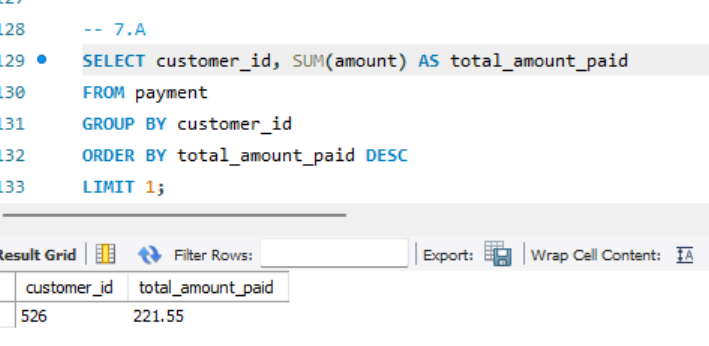
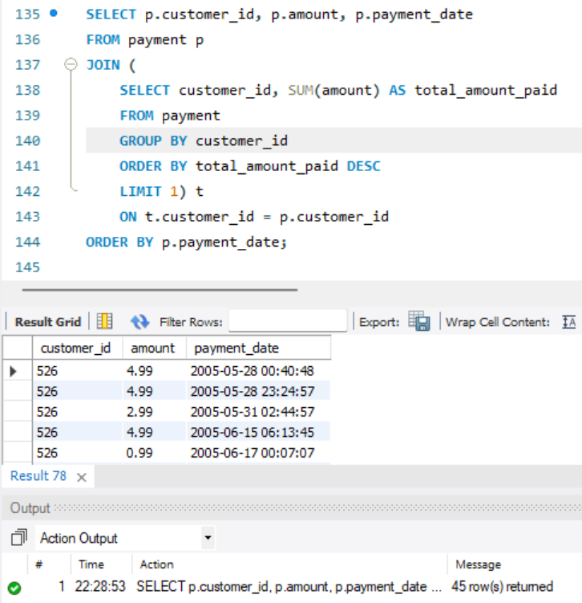

# MySQL_Chapter7 Subqueries

<b>Table of Content</b>
- [Summary](#summary)
- [Author](#author)
- [New Concepts Used](#list-of-new-concepts-used)
- [Query 1: WHERE subquery returning one value](#query-1-where-subquery-returning-one-value)
- [Query 2: WHERE clause using IN operator subquery returning a list](#query-2-where-clause-using-in-operator-subquery-returning-a-list)
- [Query 3: WHERE clause using the ALL operator subquery returning a list](#query-3-where-clause-using-the-all-operator-subquery-returning-a-list)
- [Query 4: WHERE correlated subquery running multiple times (once for each outer
row)](#query-4-where-correlated-subquery-running-multiple-times-once-for-each-outer-row)
- [Query 5: WHERE subquery using EXISTS operator returning a Boolean value](#query-5-where-subquery-using-exists-operator-returning-a-boolean-value)
- [Query 6: SELECT subquery returning a single value](#query-6-select-subquery-returning-a-single-value)
- [Query 7: FROM subquery returning a inline view (temporary table)](#query-7-from-subquery-returning-a-inline-view-temporary-table)

## Summary
This project is a collection of more advanced SQL queries using subqueries, aggregate functions, and different types of joins. The queries focused on retrieving and analyzing customer payment data from a MySQL database. Worked with IN, NOT EXISTS, correlated subqueries, and inline views, while rewriting subqueries using INNER JOIN and LEFT JOIN to understand different ways of retrieving the same data.

## List of New Concepts Used 
- IN Operator & Subqueries: Used subqueries in the WHERE clause to retrieve payments belonging to customers associated with a specific store.
- Correlated Subqueries: Used subqueries that reference the outer query to calculate each customer's average payment and count payments greater than their individual average.
- SELECT Subqueries: Used correlated subqueries with MAX() to find each customer's most recent payment date.
- Inline Views (FROM Subqueries): Created temporary result sets to identify the customer with the highest total payment and retrieve all of their payment records.
  
## Console output testing as images
### Query 1: WHERE subquery returning one value

### Query 2: WHERE clause using IN operator subquery returning a list

### Query 3: WHERE clause using the ALL operator subquery returning a list

### Query 4: WHERE correlated subquery running multiple times (once for each outer row)

### Query 5: WHERE subquery using EXISTS operator returning a Boolean value

### Query 6: SELECT subquery returning a single value

### Query 7: FROM subquery returning a inline view (temporary table)

## Author
**Suna Aregay**  
GitHub: [@suna2km](https://github.com/suna2km)

